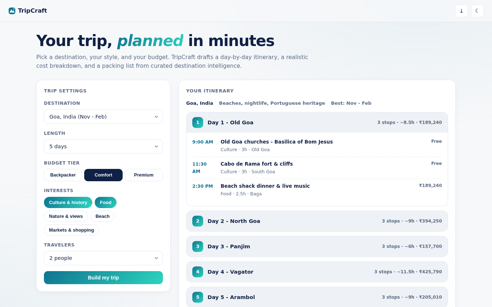
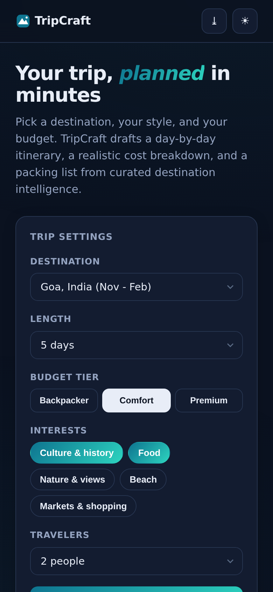

# TripCraft - Trip Planner

Pick a destination, style, and budget - get a **day-by-day itinerary, realistic cost breakdown, and packing list** in seconds. No account, no API keys.

**Live demo:** https://akash991833.github.io/travel-planner/

## Features

- **8 curated destinations** - Goa, Jaipur, Manali, Bali, Bangkok, Dubai, Paris, Tokyo - 16 real attractions each with area, duration, and list price
- **Smart itinerary builder** - scores activities by your interests, clusters stops by area so each day stays walkable, paces 2-4 stops per day with realistic time slots
- **Budget estimator** - lodging / food / transport / activities split by tier (Backpacker / Comfort / Premium), travelers multiplier, visual breakdown bar
- **Packing list** - generated from your actual itinerary (beach days mean swimwear; temple days mean modest outfits), with tap-to-check progress
- **PWA** - installable, offline after first load
- **Premium UI** - white professional design, navy ink, teal accent, dark + light themes, responsive desktop and mobile

## Screenshots

## Honest limits

Destination data is curated and static - real editorial knowledge, not live prices or availability. Nothing is booked here; it's the plan you take to booking sites. Stated in-app.

## Tech

Vanilla HTML/CSS/JS, zero dependencies, zero network calls.

## Run locally

Open `index.html` or serve the folder (`python3 -m http.server`).
